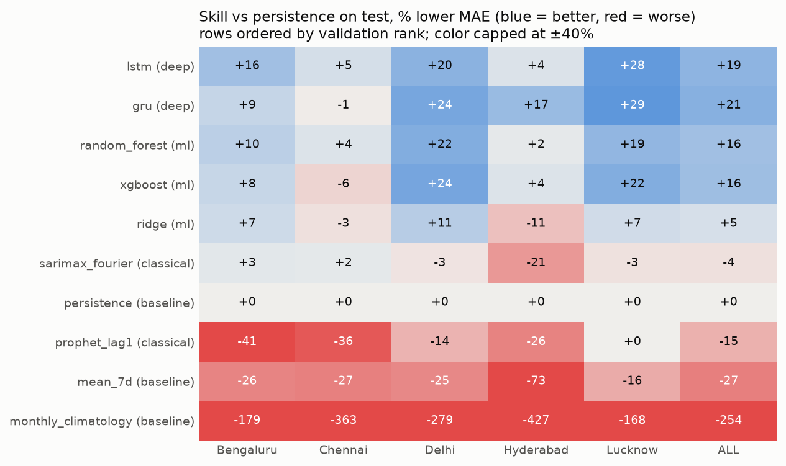
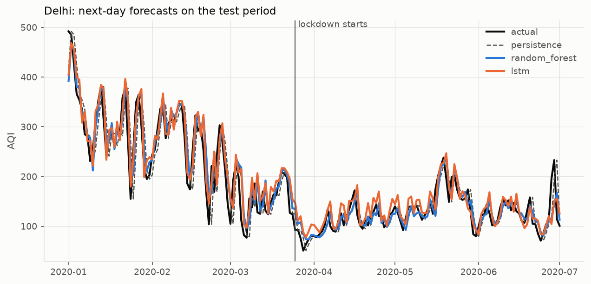
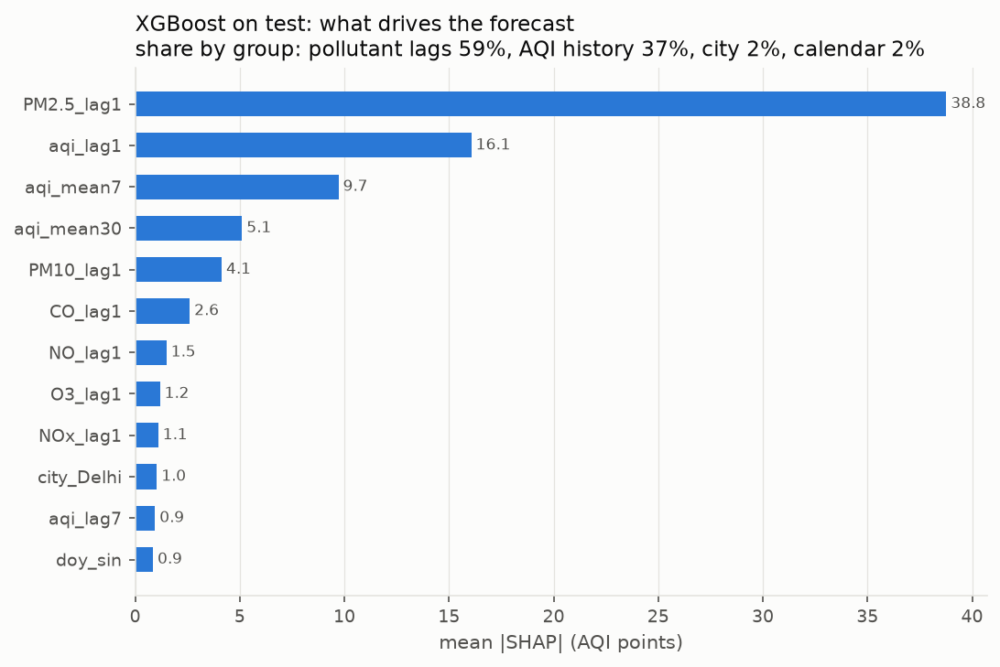
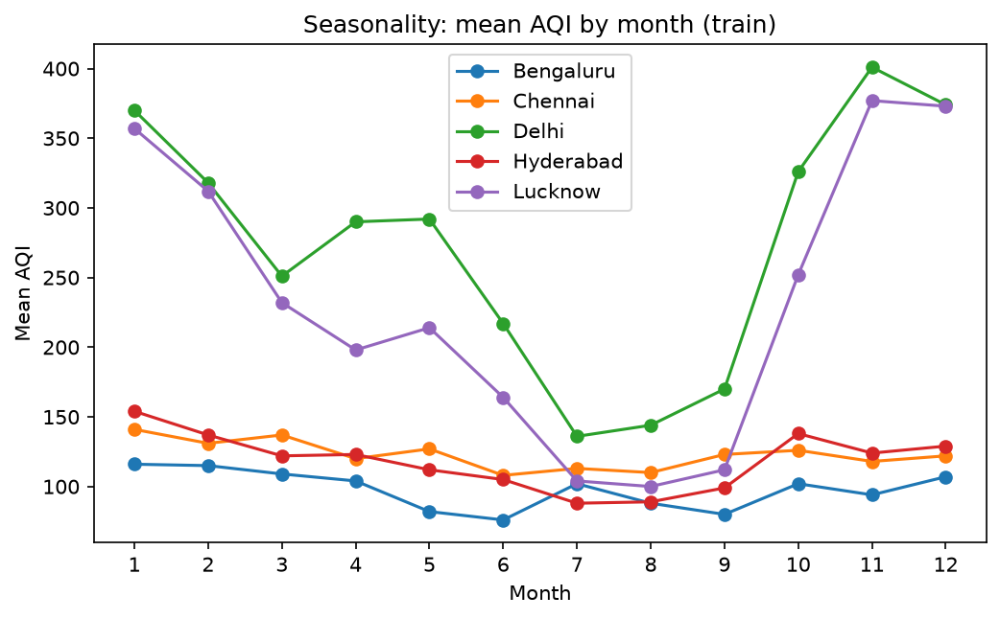

# India AQI Forecasting

Forecasting **next-day Air Quality Index (AQI)** for five Indian cities, comparing 10 models from simple baselines to LSTM/GRU networks under one leakage-safe protocol. Every choice is made on 2019 validation data. The 2020 test period, which includes the COVID-19 lockdown, is scored once at the end.

**Headline:** the final model, an **LSTM chosen on validation**, cuts next-day error by **19%** against "tomorrow = today" on held-out 2020 data (MAE 14.7 vs 18.2 AQI points). Tree models and recurrent networks all beat persistence significantly. The gap between them is small, and it shrinks to almost nothing once lockdown cleaned the air.

## Results at a glance

Pooled over the five cities. MAE is in AQI points, lower is better. Relative MAE is the mean over cities of MAE ÷ persistence MAE (below 1 beats persistence), so every city counts equally.

| Model | Family | Val rel. MAE | Test MAE | Test, before lockdown | Test, during lockdown | Test skill vs persistence |
|---|---|---|---|---|---|---|
| **LSTM** (final) | deep | **0.782** | 14.7 | 17.5 | 12.3 | +19% |
| GRU | deep | 0.784 | **14.4** | **17.1** | **12.0** | **+21%** |
| Random Forest | ML | 0.820 | 15.4 | 18.8 | 12.4 | +16% |
| XGBoost | ML | 0.842 | 15.2 | 18.3 | 12.6 | +16% |
| Ridge | ML | 0.934 | 17.3 | 21.5 | 13.7 | +5% |
| SARIMAX + Fourier | classical | 0.975 | 18.9 | 23.3 | 15.1 | −4% |
| Persistence | baseline | 1.000 | 18.2 | 24.3 | 13.1 | 0% |
| Prophet (lag-1) | classical | 1.128 | 20.9 | 24.6 | 17.8 | −15% |
| 7-day mean | baseline | 1.340 | 23.1 | 30.5 | 16.7 | −27% |
| Monthly climatology | baseline | 2.118 | 64.5 | 59.1 | 69.0 | −254% |

Full tables: [`reports/tables/comparison_scores.csv`](reports/tables/comparison_scores.csv), [`comparison_selection.csv`](reports/tables/comparison_selection.csv), [`comparison_dm.csv`](reports/tables/comparison_dm.csv).





## Key findings

1. **The best models beat persistence, and the gain is not chance.** LSTM, GRU, Random Forest and XGBoost all beat persistence on test, pooled over cities (Diebold-Mariano p < 0.001). The gain is not significant in Chennai, or in Hyderabad except for the GRU.
2. **Deep vs tree models is close.** The LSTM is significantly better than Random Forest only in Lucknow (p = 0.002). Pooled over cities, p = 0.08.
3. **Classical models barely beat persistence.** AQI tomorrow is mostly AQI today (lag-1 autocorrelation is 0.89 in Delhi, 0.91 in Lucknow). SARIMAX gains 4% on validation and loses 4% on test, and Prophet is worse than persistence.
4. **Yesterday's pollutants carry the signal, not AQI history.** With AQI-history features only, every ML model ties persistence (relative MAE 1.00–1.03). Adding lag-1 pollutants is what brings the 15–20% gain. SHAP puts 59% of XGBoost's signal on pollutant lags (PM2.5 alone 43%) and 37% on AQI history.
5. **The lockdown erased most of the gain.** Before 25 Mar 2020 the GRU beats persistence by about 30%; during the lockdown by about 8%. Climatology, which assumes past seasonal levels, fails badly.
6. **Severe days improve the most.** On days with AQI ≥ 300 (Delhi and Lucknow, n = 42 on test), MAE falls from 42.6 with persistence to 21.4 with the LSTM.
7. **Categories are mostly right, and misses are near.** The LSTM gets the CPCB category right on 756 of 915 test days. Almost every miss is the neighbouring category.



## Problem and data

- **Task:** supervised time-series regression. Predict AQI for day *d* using only information up to day *d − 1*, plus calendar features of day *d*, which are known in advance.
- **Data:** [Air Quality Data in India (2015–2020)](https://www.kaggle.com/datasets/rohanrao/air-quality-data-in-india) on Kaggle, compiled from CPCB. The project uses `city_day.csv`, with daily AQI and 12 pollutants. The raw data is not committed to this repo.
- **Cities:** Delhi, Bengaluru, Chennai, Hyderabad, Lucknow. They were chosen for complete daily coverage and low AQI missingness.
- **Cleaning** (`src/cleaning.py`, `src/make_dataset.py`):
  - one row per city per calendar day, so lags count real days;
  - negative concentrations set to missing;
  - AQI capped at 500, the top of the CPCB scale;
  - pollutant gaps of up to 3 days forward-filled, past only. AQI itself is never filled.



## Evaluation protocol

| Split | Dates | Used for |
|---|---|---|
| Train | 2015-01-01 – 2018-12-31 | fitting |
| Validation | 2019 | every choice: model orders, features, hyperparameters, epochs, final model |
| Test | 2020-01-01 – 2020-07-01 | reported once, never used for a choice |

Safeguards against leakage, each covered by tests:

- **Split dates live in one place,** `src/config.py`, so no script can define its own.
- **EDA and preprocessing rules use the train split only.** That includes which pollutants count as "core" (≤ 25% missing in every city).
- **Scalers and imputers are fitted on the rows a model is trained on only.**
- **Validation forecasts come from train-only fits.** Test forecasts come from a refit on train + validation, with the settings chosen on validation.
- **Leakage tests change a future test day and check that no earlier forecast moves.** There's one for every model family.

Metrics: MAE (primary), RMSE, MAPE, and CPCB category accuracy, per city and pooled. Every model is scored on exactly the same rows. Significance is a Diebold-Mariano test on absolute errors, with Newey-West variance and the Harvey-Leybourne-Newbold correction. The pooled test averages the cities for each date first.

## Models

| Phase | Models | Notes |
|---|---|---|
| 3 · Baselines | persistence, 7-day mean, seasonal naive (7 / 365 days), monthly climatology | `src/baselines.py` |
| 4 · Classical | SARIMAX on log AQI with Fourier yearly seasonality; Prophet with yesterday's AQI as a regressor | ARMA order and Fourier K chosen per city on validation (`src/classical.py`) |
| 5 · ML | Ridge, Random Forest, XGBoost | AQI lags (1, 2, 3, 7), 7- and 30-day trailing means, lag-1 pollutants, day-of-year, city. Feature set and hyperparameters chosen on validation. One model for all cities beat per-city models for the tree models (`src/features.py`, `src/ml_models.py`) |
| 6 · Deep | LSTM, GRU (PyTorch) | 14- or 30-day window of AQI and core pollutants, plus day-of-year and city. Hidden size and window chosen on validation, epochs by early stopping on validation (`src/deep_models.py`) |
| 7 · Comparison | all of the above | same rows, lockdown split, significance tests, SHAP (`src/comparison.py`) |

Chosen configurations:
- SARIMAX: per city, in [`sarimax_selection.csv`](reports/tables/sarimax_selection.csv).
- XGBoost: all pollutants, depth 5, 200 trees.
- Random Forest: all pollutants, min leaf 10.
- LSTM: 64 hidden units, 14-day window, 33 epochs.
- GRU: 32 hidden units, 14-day window, 31 epochs.

## Limitations

- **The test period has a regime shift.** Over half of it falls in the COVID-19 lockdown, when AQI dropped sharply. The test numbers show how the models generalise to an unusual period, not typical performance.
- **There is only one validation year.** Models that score within a few hundredths of each other on validation (LSTM 0.782, GRU 0.784) can't be told apart reliably.
- **The deep models' validation scores are slightly optimistic,** because early stopping also looked at validation. The test columns are the fair comparison with the ML models.
- **Some cities have missing data.** Pollutant coverage varies by city (PM10 and Xylene are 100% missing in some), and AQI is missing on up to 9% of training days (under 1% in Delhi).
- **The data ends on 2020-07-01.** The app forecasts the day after that, not today.

## Reproducing

```bash
# 1. environment (Python 3.13)
pip install torch==2.14.1 --index-url https://download.pytorch.org/whl/cpu
pip install -r requirements.txt

# 2. data: download city_day.csv from Kaggle and put it in data/raw/

# 3. everything, in order (about 15 minutes on a laptop CPU)
python -m src.run_all

# 4. tests
python -m pytest
```

`run_all` runs these stages in order. Each can also be run alone with `python -m src.<stage>`, or the pipeline restarted from one with `python -m src.run_all --from <stage>`:

| Stage | Writes |
|---|---|
| `make_dataset` | `data/processed/aqi_clean.csv` |
| `eda` | train-only EDA tables and figures |
| `run_baselines` | `baseline_results*.csv`, baseline figures |
| `run_classical` | `classical_results.csv`, `sarimax_selection.csv` |
| `run_ml` | `ml_*.csv` |
| `run_deep` | `deep_*.csv` |
| `run_comparison` | `comparison_*.csv`, comparison figures |
| `export_models` | `models/lstm.pt`, `models/xgboost.json` (checked against the saved test forecasts) |

Everything is seeded and pinned. Running the pipeline from the raw data reproduces the committed tables in `reports/`.

## App

```bash
streamlit run app/streamlit_app.py
```

- **Next-day forecast:** LSTM, XGBoost and persistence for 2 Jul 2020 with the CPCB category, plus what-if sliders for the last day's PM2.5 and AQI.
- **History:** interactive actual vs forecasts over validation and test, with the lockdown marked and error metrics for any date range.
- **Data & EDA:** the train-split analysis as interactive charts: seasonality by month, weekday and year; share of days per CPCB category; autocorrelation; next-day pollutant correlations; missing data. There's a city filter, and each chart has a takeaway and its numbers.
- **Model analysis:** one tab per phase:
  - Baselines: MAE by city.
  - Classical: SARIMAX and Prophet vs persistence, with the chosen settings.
  - Machine learning: the effect of each feature set, feature importance, one model vs one per city.
  - Deep learning: every LSTM/GRU configuration tried.
  - Comparison: the skill heatmap for any period, before vs during the lockdown, severe days, the category confusion matrix, SHAP.
- **Leaderboard:** the ranking, MAE by city before and during the lockdown, and the significance tests.
- **About:** the method and caveats.

The app needs the processed data and the exported models, which are not committed. If they are missing, it lists the commands to run.

## Project structure

```
src/
  config.py            cities, paths, split dates (single source of truth)
  data_loader.py       read and validate the raw CSV
  cleaning.py          reindexing, masking, capping, past-only gap filling
  split.py             chronological train / val / test labels
  make_dataset.py      build data/processed/aqi_clean.csv
  eda.py               train-only exploratory analysis
  evaluation.py        metrics shared by every model
  baselines.py         persistence, moving average, seasonal naive, climatology
  classical.py         SARIMAX and Prophet
  features.py          lag / rolling / calendar features
  ml_models.py         Ridge, Random Forest, XGBoost with validation selection
  deep_models.py       LSTM / GRU in PyTorch with validation selection
  comparison.py        unified scoring, Diebold-Mariano, SHAP
  app_logic.py         model save/load and next-day forecasting for the app
  app_charts.py        interactive charts for the app's analysis tabs
  run_*.py, export_models.py, run_all.py   pipeline entry points
app/streamlit_app.py   the app
tests/                 unit and leakage tests for every module
reports/tables/        result tables (committed)
reports/figures/       figures (committed)
data/, models/         generated locally, not committed
```

## Status

- [x] Phase 0: repo setup
- [x] Phase 1: data cleaning
- [x] Phase 2: EDA
- [x] Phase 3: baselines
- [x] Phase 4: classical models
- [x] Phase 5: ML models
- [x] Phase 6: LSTM / GRU
- [x] Phase 7: comparison
- [x] Phase 8: app
- [x] Phase 9: docs and reproducibility
